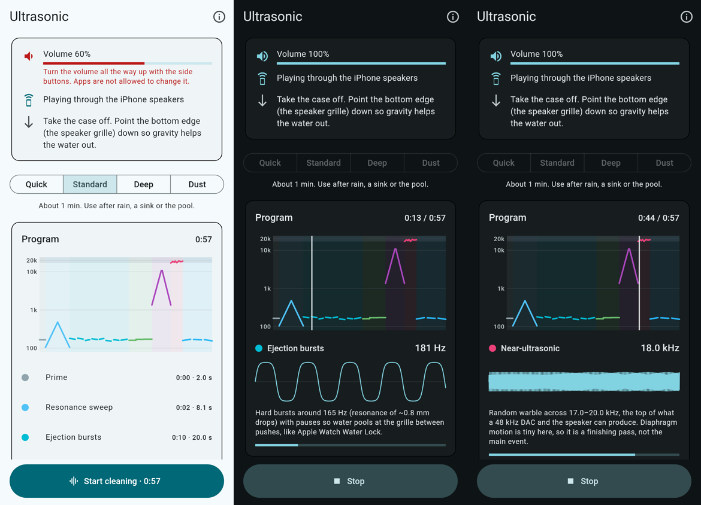
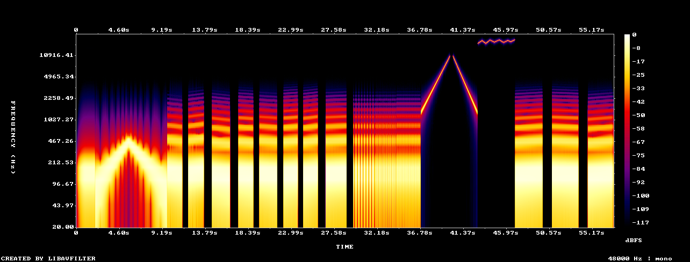

# Ultrasonic

An iPhone app that generates tone programs to push water and loose debris out
of the speaker grilles. Each program is built from a seed, so every run is a
little different. The tones are synthesised one sample at a time inside the
Core Audio render callback (`AVAudioEngine` + `AVAudioSourceNode`), at the
hardware sample rate, with nothing resampled on the way to the speaker amp.



## About "ultrasonic"

True ultrasonic sound will not clean an iPhone speaker, for two reasons:

1. **The hardware can't produce it.** iPhone audio runs at 48 kHz, so 24 kHz
   is a hard ceiling (Nyquist). The analog path and the micro-speaker fall off
   sharply above about 20 kHz; measurements on iPhone 7/8 show usable output
   only up to the 17–19 kHz range.
2. **It's the wrong mechanism.** Ultrasonic cleaners work by *cavitation*:
   piezo transducers at 20–40 kHz and tens to hundreds of watts make bubbles
   collapse in a liquid bath. A phone speaker in air does nothing like that.

What does work is **low-frequency, high-excursion** motion. At equal loudness,
diaphragm displacement scales with 1/f². A 165 Hz tone moves the diaphragm
roughly 15,000 times further than a 20 kHz tone, and that motion is what pumps
air through the grille and throws water out. 165 Hz is the tone the Sonic app
used for the iPhone 7, the tone the "Water Eject" shortcuts copied, and the
same approach as Apple Watch Water Lock.

So the app is built around low frequencies. It still has a **near-ultrasonic
stage (17–20 kHz)**, the highest the hardware can go, but as a short
finishing pass, not the main event. You can turn it off.

## How the program is designed

| Finding | What the generator does with it |
|---|---|
| Water in the grille resonates around 165 Hz; the best value varies a little by phone and by how much water there is | Ejection bursts centred on 165 Hz (adjustable 140–200 Hz), each one gliding ±1–4% so it sweeps through the local resonance instead of guessing it |
| Rayleigh's drop-oscillation formula, f = (1/2π)·√(l(l−1)(l+2)·σ/ρR³), gives ~169 Hz for a 0.8 mm drop, 480 Hz for 0.4 mm and 1.4–11 kHz for 50–200 µm beads in the mesh | A **resonance sweep** across 105–478 Hz for grille-sized drops, and a **micro-droplet sweep** across 1.35–10.8 kHz for mesh-pore droplets. All of these bands are computed from the formula in `droplet_physics.dart` |
| Apple Watch runs, pauses and runs again, because each push also draws some water back in | 0.5–0.9 s pauses between bursts so water can pool at the grille before the next push |
| Displacement ∝ 1/f² | All the heavy lifting happens below 500 Hz. The saturated (`tanh`) waveform keeps the cone near full excursion for longer each cycle |
| Micro-speakers resonate around 1 kHz, and the iPhone's smart amp limits excursion and coil temperature | No tones below 100 Hz, where the amp would just turn them down. Peak level stays at −0.4 dBFS, and harmonic-rich waveforms are only used below 1 kHz |
| Ears are most sensitive at 2–5 kHz | Everything above 1 kHz runs at 35–50% amplitude |
| A drop sitting at a quiet spot for one frequency won't sit there for all of them | Seeded randomness varies burst frequency, length, drive, pause lengths, pulse rates and the warble path. A new seed is drawn after every completed run |

Stages of the standard (~1 min) program:

| Stage | Signal | Purpose |
|---|---|---|
| Prime | 165 Hz sine with a slow fade-in | Starts the water moving without a startling jolt |
| Resonance sweep | Log chirp 105 → 478 → 105 Hz | Hits every grille-sized drop at its own resonance |
| Ejection bursts | 8 × saturated ~165 Hz bursts with pauses | The main push |
| Pumping | 165 Hz gated at 3 → 11 Hz | Lets the diaphragm work like a piston pump |
| Micro-droplet sweep | 1.35 ↔ 10.8 kHz, quieter | Shakes the small beads stuck in the mesh |
| Near-ultrasonic | Random warble across 17–20 kHz | The top of the hardware's range |
| Final purge | 3 longer low bursts with a soft ending | Throws out whatever the earlier stages loosened |

**Quick** (~30 s) is a shorter version. **Deep** (~2 min) runs two full cycles
with a rest in between. **Dust** swaps the bursts for low-passed noise bursts,
because a sound can only shake loose dust and lint; anything packed into the
grille needs a dry, soft brush.

Spectrogram of a standard program (`--seed 42`), log frequency axis:



## Architecture

```
Dart (lib/)                                     Swift (packages/speaker_tone_engine/ios)
──────────────────────────────────────────      ─────────────────────────────────────────────
ProgramGenerator(options, seed)                 SpeakerToneEnginePlugin (method + event channels)
  → CleaningProgram (stages + ToneSegments)  →    → ToneSegmentSpec (validated)
                                                  → ToneRenderer  ← runs in the render block
SpeakerToneEngine (MethodChannel/EventChannel)   AVAudioSourceNode → mainMixer → output → speaker amp
ToneRenderer (Dart): same per-sample maths, used for tests, WAV export and the on-screen scope
```

- **`lib/src/cleaning/`**: pure Dart. The droplet physics, the seeded program
  generator and the controller.
- **`packages/speaker_tone_engine/`**: a local Flutter plugin.
  - `lib/src/tone_segment.dart`: the segment model and wire format (sine,
    saturated or noise; linear or exponential sweep; AM; raised-cosine fades).
  - `lib/src/tone_renderer.dart`: the Dart reference renderer.
  - `ios/.../ToneRenderer.swift`: the same maths, real-time safe. Segments are
    copied into a raw buffer up front, so the render path never allocates,
    locks or touches ARC. Phase runs continuously across segments, so there
    are no clicks.
  - `ios/.../ToneEngine.swift`: the `AVAudioSession` and `AVAudioEngine` code.
    - Uses the `.playback` category, which also plays with the Silent switch on.
    - Asks for 48 kHz and a 10 ms I/O buffer.
    - Writes the same signal to both channels. On iPhone 7 and later the
      earpiece is the second stereo speaker, so both grilles are driven.
    - Keeps the screen awake during a run.
    - Stops on interruptions, on route changes and when the app goes to the
      background.
    - Between runs, holds a mixable `.ambient` session so it can watch the
      volume and the output route without stopping the user's music.

The Dart and Swift renderers implement the same formulas. If you change one,
change the other.

## Running it

Requirements: Flutter 3.47+ (stable), Xcode, and a physical iPhone. The
simulator plays through the Mac's speakers, so it only works as a UI check.

```sh
flutter pub get
open ios/Runner.xcworkspace   # set your signing team once
flutter run --release         # with the iPhone connected
```

Before running a program: take the case off, turn the volume all the way up
(apps aren't allowed to change it; the app warns you if it's low), and point
the bottom edge down.

### Try the sound without building the app

The command-line renderer uses the same generator and renderer as the app:

```sh
dart run tool/render_wav.dart --mode standard --seed 42 -o standard.wav
dart run tool/render_wav.dart --mode deep --hz 172 --no-high -o deep.wav
```

AirDrop the WAV to the phone and play it at full volume. On a device, the app
is still better: it renders at the hardware rate, refuses to play through
headphones, and keeps the screen awake.

## Tests

```sh
flutter test                                        # generator, physics, UI (103 tests)
(cd packages/speaker_tone_engine && flutter test)   # renderer DSP, channel contract (21 tests)
```

The renderer tests check the signal itself:

- frequency, measured with Goertzel and zero-crossing counts
- equal time per octave on exponential sweeps
- no clicks across segment boundaries
- AM gating, noise bounds and determinism
- the Nyquist guard
- chunked rendering matching one-shot rendering

The generator tests render every mode for several seeds and check length,
playable frequencies, level caps, stage tiling, and that nothing clips or
produces NaN.

## Safety and limits

- The app will not play through headphones or Bluetooth, and stops if one
  connects mid-run.
- If it's still muffled after two runs, stop and let the phone dry speaker
  side down on a lint-free cloth (Apple's advice). Don't put anything into the
  openings, and don't charge while the port is wet.
- 17–20 kHz is inaudible to most adults but not to children, dogs or cats.
- This moves water and loose debris out of the grille and the acoustic mesh.
  It can't reach liquid that got further inside the phone.

## Sources

- [BGR: free app ejects water from the iPhone 7 speaker (Sonic, 165 Hz)](https://bgr.com/tech/iphone-7-waterproof-test-get-water-out-of-speaker/)
- [Sonic tone generator (App Store)](https://apps.apple.com/app/id986999895)
- [Fix My Speakers](https://fixmyspeakers.com/)
- [9to5Mac: Apple Watch water ejection in slow motion (run, pause, run)](https://9to5mac.com/2020/06/19/apple-watch-water-ejection-system/)
- [Apple: If you see a liquid-detection alert on your iPhone](https://support.apple.com/en-me/102643)
- [Apple: Configuring device hardware (AVAudioSession sample rate and buffer)](https://developer.apple.com/library/content/documentation/Audio/Conceptual/AudioSessionProgrammingGuide/OptimizingForDeviceHardware/OptimizingForDeviceHardware.html)
- [Apple Developer Forums: iPhone 6s speaker supports only 48 kHz](https://developer.apple.com/forums/thread/23135)
- [SonicPACT: ultrasonic ranging on commodity phones (iPhone 7/8 response above 20 kHz)](https://arxiv.org/pdf/2012.04770)
- [Analog Devices: micro-speakers, ~1 kHz resonance, excursion and thermal protection](https://analog.com/cn/technical-articles/unleash-the-full-potential-of-your-micro-speakers.html)
- [Grimm Audio: diaphragm motion vs frequency at constant SPL](https://www.grimmaudio.com/wordpress/wp-content/uploads/Grimm-Audio-Motional-feedback-essentials-Rob-Munnig-Schmidt.pdf)
- [Branson: ultrasonic cleaning primer (cavitation, 20–40 kHz)](https://www.branson.emerson.com/is/content/emerson/en/corporate/branson/documents/brochure-cleaning-primer-branson-en-us.pdf)
- Lord Rayleigh, "On the capillary phenomena of jets", Proc. R. Soc. Lond. 29 (1879): drop oscillation modes
